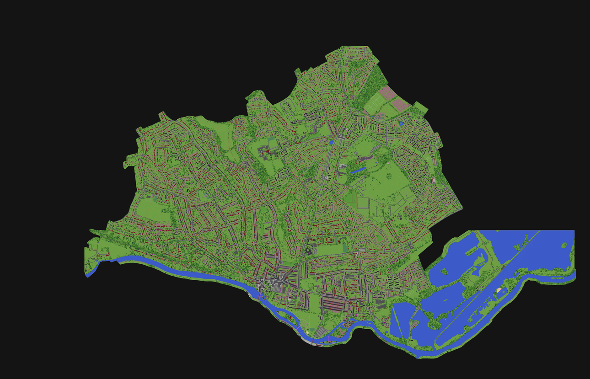

# Cavcraft

Caversham as a Minecraft Java world, 1 block = 1 metre, built from OpenStreetMap and Environment Agency LiDAR.
All of Caversham (Heights, Emmer Green, Caversham Park Village, Lower Caversham), the Thames with its bridges and
islands, Caversham Lakes with the beach, and a working Caversham Lock. Not Reading: the world stops just past the
south bank. Y in the world = metres above sea level (Ordnance Datum).

## Download and play (free)
1. Download **Cavcraft.zip** from the [latest release](https://github.com/a-adz-1/cav-craft/releases/latest).
2. Unzip it. You get a folder called `Cavcraft`.
3. Put that folder in your Minecraft Java `saves` folder:
   - Windows: press Win+R, type `%appdata%\.minecraft\saves`, press Enter
   - Mac: in Finder, Go → Go to Folder → `~/Library/Application Support/minecraft/saves`
   - Linux: `~/.minecraft/saves`
4. Start Minecraft Java Edition (1.21 or newer) → Singleplayer → **Cavcraft**.

Bedrock Edition (tablets, consoles, Windows Bedrock) is coming later.

## Play it (from a checkout)
Copy `world/Cavcraft` (or unzip `build/Cavcraft.zip`) into your Minecraft `saves` folder. Made for 1.21.1 format;
any newer Java Edition upgrades it on first open (tested in 1.21.11). Creative mode, cheats on, no mob spawning,
no generated terrain outside Caversham.

- Spawn: north end of Caversham Bridge.
- Caversham Lock: x 4043–4076, z 4164–4169 (`/tp 4040 38 4174`). Buttons on the south wall: "Down to Reading
  Bridge" and "Up to Caversham Bridge". There's a boat in the chamber.
- Caversham Lakes beach: `/tp 6060 37 3520`.

Places worth a visit (`/tp x y z`):

| Place | Teleport |
|---|---|
| St Peter's Church and Caversham Court gazebo | `/tp 2860 56 3330` |
| Caversham Library clock tower, Church Street shops | `/tp 3330 52 3410` |
| Star Road grey-brick terraces, Red Cow | `/tp 4448 45 3470` |
| Fry's Island, boat clubhouse, moored boats | `/tp 3330 52 3830` |
| Reading Rowing Club | `/tp 2997 45 3570` |
| The Warren riverside villas | `/tp 1880 55 3175` |
| Caversham Park mansion | `/tp 4463 110 2000` |
| Emmer Green water tower | `/tp 4185 105 745` |
| Redgrave Pinsent Rowing Lake lanes | `/tp 6000 60 2900` |
| Reading Winter Wonderland (Hills Meadow) | `/tp 3830 42 4081` |
| Whittington's Tea Barge | `/tp 3895 40 4110` |
| Caversham Weir footbridge | `/tp 3993 40 4112` |
| War memorial, Christchurch Meadows | `/tp 3262 44 3672` |
| Environment Agency and Thames Water | `/tp 3812 50 4292` |

## How the buildings were made
Every building is its OpenStreetMap outline with a roof fitted to the Environment Agency LiDAR (hipped, gabled
or flat, at the measured eave and ridge heights). Street by street, the style (brick, render, tile-hanging,
Tudor gables, bays, front walls or hedges) comes from looking at Mapillary street photos and Geograph photos on
Wikimedia Commons: `docs/street_survey.csv` (159 streets surveyed; the rest follow their nearest surveyed
street). About 30 landmarks (churches, pubs, the library, the lock, the water tower...) are built individually
from their photos in `tools/landmarks.py`. Photos are reference only and are not in the repo or the world.

## Rebuild
    uv venv .venv && uv pip install --python .venv/bin/python numpy tifffile imagecodecs pyproj shapely pillow osmium scipy
    # data: Geofabrik berkshire + oxfordshire .osm.pbf in .downloads/osm, EA LiDAR tiles (splitwater/.downloads/ea)
    PROJ_NETWORK=ON .venv/bin/python tools/osm_extract.py .downloads/osm/*.osm.pbf build/osm.json
    .venv/bin/python tools/lidar_mosaic.py ~/Projects/splitwater/.downloads/ea build/lidar.npz
    .venv/bin/python tools/layers.py build/osm.json build/lidar.npz build/layers.npz
    .venv/bin/python tools/build_world.py world/Cavcraft        # ~15 s
    .venv/bin/python tools/test_anvil.py                        # format self-check
    .venv/bin/python tools/render_world.py world/Cavcraft out.png 0.25   # top-down check from the saved files
    .venv/bin/python tools/mc_view.py world/Cavcraft shot.png x y z yaw pitch   # screenshot in real Minecraft

See BRIEF.md for the goals and PROGRESS.md for what was done and decided. Credits: CREDITS.md.
